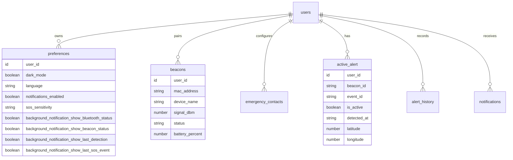
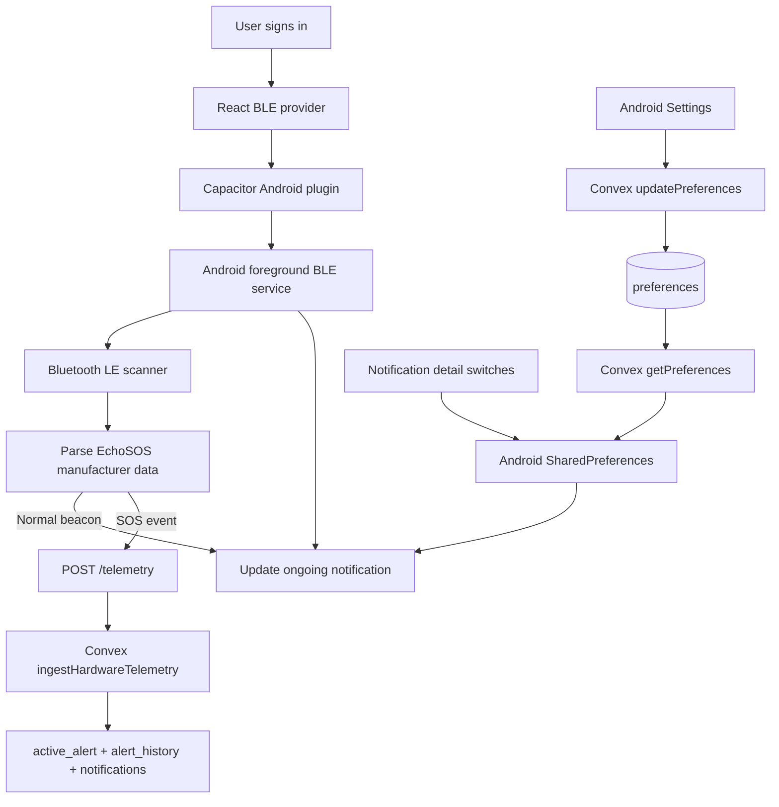

# Android background beacon monitoring

EchoSOS starts native BLE monitoring after an authenticated user session is available. The Android service is independent of the React provider lifecycle, so it continues while the activity is minimized or removed from the recent-apps screen.

## Persistent notification

The foreground-service notification is mandatory while the service is running. It has no pause or stop action. The Settings screen only controls which diagnostic details are displayed:

- Bluetooth adapter and scanner state
- Latest beacon mode and ID
- Last beacon detection time
- Latest SOS reporting state

All four detail switches default to enabled. Turning a detail off does not stop BLE scanning or stop the foreground service. If every detail is hidden, the notification still says that background protection is active.

## Permissions and startup

The app requests Bluetooth scan/connect permission and Android 13+ notification permission when the user is logged in. The service must be started while the app activity is visible, which is why startup happens from the authenticated app lifecycle rather than a background receiver.

The manifest declares the Android `connectedDevice` foreground-service type. The native service uses Android's BLE scanner and parses the EchoSOS manufacturer-data payload (company ID `0xE505`).

## SOS reporting

When the service observes an emergency-mode advertisement with a non-zero event ID, it sends one telemetry request for that event to the configured Convex `/telemetry` endpoint. It includes the beacon MAC address, event ID, and signal strength; the last known device location is included when Android makes it available. A cancellation-mode advertisement is shown in the notification as a verification prompt; this service does not silently cancel an active alert.

The existing telemetry HTTP route is also used by hardware telemetry. It should be protected with a device-authentication/signature scheme before production deployment; a BLE MAC address alone is not a cryptographic identity.

## Limits and verification

- The foreground service is designed to survive ordinary activity dismissal and process recreation (`START_STICKY`).
- Android force-stop, revoked Bluetooth permission, disabled Bluetooth, vendor battery policies, or OS restrictions can stop monitoring. No application can guarantee execution after a user force-stops it.
- This implementation does not add automatic startup after device reboot. Open EchoSOS and sign in again after a reboot.
- Android may place foreground-service notices in its Task Manager rather than the notification drawer when notification permission is denied.

## Device test checklist

1. Install the native Android build and sign in.
2. Grant Nearby devices/Bluetooth and notification permissions.
3. Confirm the ongoing EchoSOS notification appears and shows the default diagnostics.
4. Turn off each notification detail in Settings and confirm the matching line disappears without stopping monitoring.
5. Minimize EchoSOS and swipe its activity away from Recents.
6. Advertise an EchoSOS registration-mode packet and confirm the beacon status and detection time update.
7. Advertise an emergency-mode packet with a non-zero event ID; confirm the notification reports the backend response and Convex receives the telemetry.
8. Turn Bluetooth off and on; confirm the notification reports the state. The service retries scanning periodically.
9. Log out and confirm the foreground service is stopped.

## Data model and runtime architecture

Background-notification choices are stored on the existing `preferences` document for each user. No separate monitor-settings table is needed.

| Convex field | Type | Default | Purpose |
|---|---|---:|---|
| `background_notification_show_bluetooth_status` | optional boolean | `true` | Show Bluetooth/scanner state |
| `background_notification_show_beacon_status` | optional boolean | `true` | Show latest beacon state |
| `background_notification_show_last_detection` | optional boolean | `true` | Show last advertisement timestamp |
| `background_notification_show_last_sos_event` | optional boolean | `true` | Show latest SOS delivery state |

The fields are optional in the schema so existing preference documents remain valid. The query and Settings UI interpret a missing field as `true`. Updating one option patches only that field. The Android native preferences mirror these values locally so notification updates do not depend on a live network connection.

The notification detail toggles affect only the notification text. They do not enable, pause, or stop the foreground service. The required ongoing service notification remains active while the monitor service is running.
